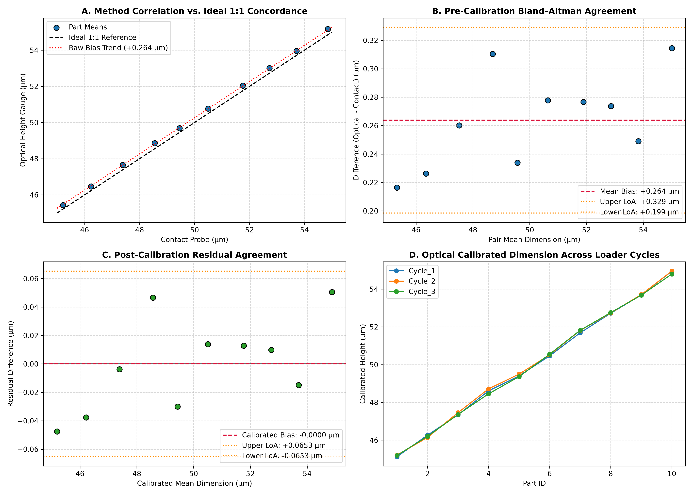

# Semiconductor Packaging Metrology & Thermo-Mechanical Modeling Portfolio

Self-directed analytical portfolio demonstrating statistical process evaluation, measurement system capability, and design of experiments (DOE) workflows for advanced semiconductor packaging.

> *Disclaimer: All datasets in this repository are synthetically simulated using physical and statistical equations to demonstrate engineering methodology without exposing proprietary industrial data.*

---

## Project 1: Non-Contact Optical Height Gauge vs. Tactile Probe (MSA & Agreement)

**Notebook:** [`01_msa_vision_vs_contact.ipynb`](01_msa_vision_vs_contact.ipynb) | **Dataset:** [`msa_optical_gauge_vs_contact.csv`](msa_optical_gauge_vs_contact.csv)

### Engineering Objective
Evaluate whether a high-throughput, non-contact 3D optical height gauge can substitute for a reference tactile stylus probe on flip-chip bond line thickness (BLT) / copper pillar heights ($50.00 \pm 5.00\text{ }\mu\text{m}$ tolerance window) using an AIAG MSA layout ($10\text{ parts} \times 3\text{ loader cycles} \times 3\text{ trials} = 90\text{ paired runs}$).

### Key Findings (Simulated Data)
* **Systematic Bias & Agreement:** Bland–Altman analysis on per-part means identified a stable **$+0.264\text{ }\mu\text{m}$** optical reflection offset ($95\%$ Limits of Agreement: $[+0.199, +0.329]\text{ }\mu\text{m}$).
* **Software Offset Calibration:** Applying a constant $-0.2639\text{ }\mu\text{m}$ software offset reduced residual bias to $0.000\text{ }\mu\text{m}$ with post-calibration $95\%$ LoA narrowing to $\pm 0.065\text{ }\mu\text{m}$.
* **ANOVA Gauge R&R Capability:** Two-way ANOVA across automated loader cycles yielded **$\%GRR = 3.95\%$**, **Precision-to-Tolerance ($P/T$) $= 7.72\%$**, and **Number of Distinct Categories ($ndc$) $= 35$**, confirming inline measurement capability.

---

## Upcoming Modules
* **Project 2 (`02_bilayer_warpage_doe.ipynb`):** Parametric $2^3$ full factorial DOE and response surface analysis of silicon-EMC bilayer thermal warpage using the Timoshenko curvature model.
* **Project 3 (`03_daisy_chain_weibull_reliability.ipynb`):** Simulated thermal-cycling resistance drift and two-parameter Weibull life comparison ($\eta, \beta$) across underfill materials.
